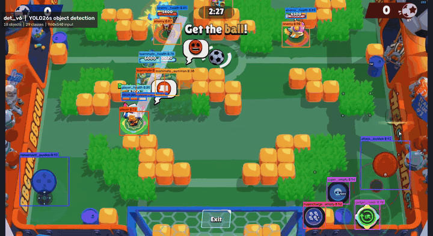
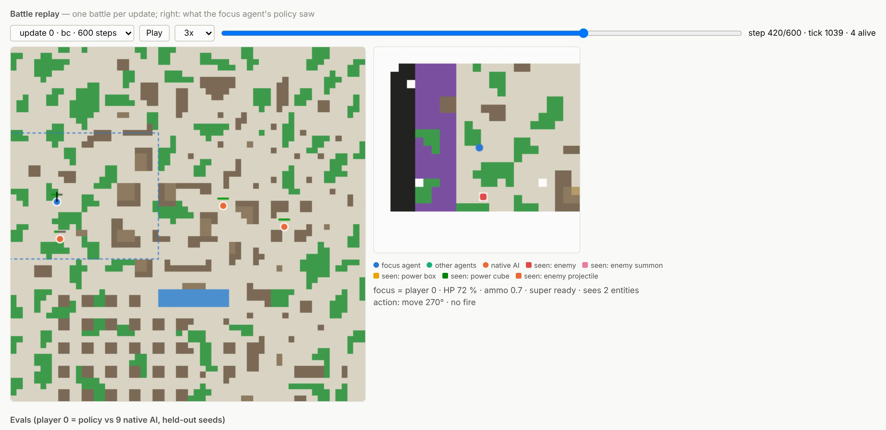
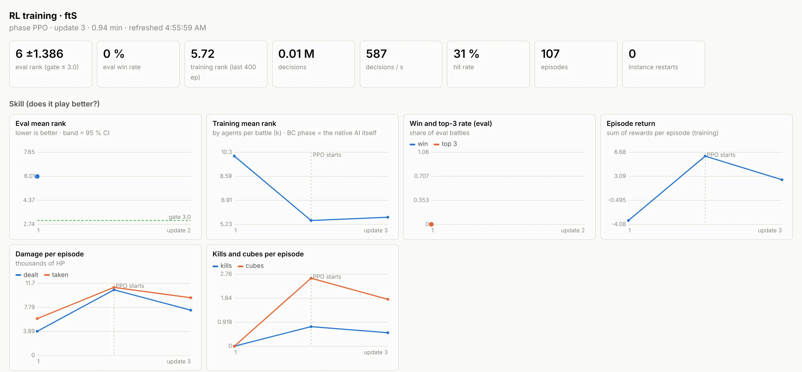
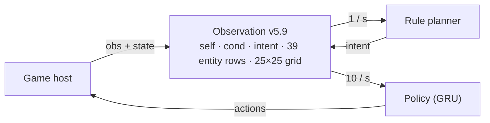
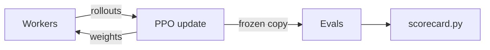

<p align="center">
  <a href="https://youtu.be/KqxcA1EehUY"></a><br>
  <sub>RL agent playing a match · <a href="https://youtu.be/KqxcA1EehUY">full video</a></sub>
</p>

<h1 align="center">bsrl-sim</h1>

<p align="center"><b>Reinforcement-learning environment and trainer for a 10-player top-down battle royale, played from imperfect perception.</b></p>

<p align="center">
  
  
  
  <a href="LICENSE"></a>
</p>

## At a glance

<p align="center">
  <br>
  <sub>Battle replay in <code>viz.html</code>: the battle on the left, what the focus agent's policy saw on the right.</sub>
</p>

<p align="center">
  <br>
  <sub>Run dashboard in <code>viz.html</code> (a short 3-update run, so the curves only show the layout).</sub>
</p>

## Contents

- [How it works](#how-it-works)
- [What is here](#what-is-here)
- [Vision models](#vision-models)
- [Requirements](#requirements)
- [Setup](#setup)
- [Notes](#notes)
- [Licence](#licence)
- [Credits](#credits)

Reinforcement-learning environment and trainer for a 10-player top-down battle royale (Showdown mode). The policy
does not get the true game state. It gets what vision models would read from the screen: a 25 x 25 tile grid of terrain
classes, a set of detected entities with measured detector noise and latency, and a few HUD numbers. That makes this a
testbed for training agents that have to act from imperfect perception, and policies trained here can run behind real
vision models without retraining.

Those vision models (detector and segmentation for Showdown) are in
**[showdown-vision](https://github.com/mlgdoggynoob/showdown-vision)**, latest release `v6`: see [Vision models](#vision-models).

The battles run in **nirkt's** battle host and environment, included under `engine/` (see Credits). `setup.sh` builds
everything. Game files are not included: you supply them.

## How it works

### One decision

The policy acts 10 times a second. About once a second the rule planner reads the same observation and picks an
intent (or none = free play), with a readable reason. The intent goes into the observation's intent block.



Observation parts: self 8 (hp, ammo, super / gadget ready, bush, velocity), cond 30 (own brawler stats + 12 play-style
sliders + HUD numbers), intent 11, entity rows 39 × 36 (below), grid 25 × 25 live tiles. The policy heads are move,
aim, fire (attack / super / gadget) and distance; in training a critic also sees the true state and aux heads predict
it (enemy position in 1 s, hit, gas, bush).

### Training loop



Reward: placement, damage, survival, slider terms × `--slider-scale`, intent following (`i_rew`, ≤ 0.15). The update
adds a KL anchor and the aux loss. Evals play vs the native AI (presets, 7 hard scenarios, planner vs free play);
`viz.html` shows the curves and replays with planner reasons.

Each training battle splits its agents: some follow planner intents (`--p-plan`), some random valid intents
(`--p-rand-intent`), the rest play free. Evals and hard scenarios always play with intent none, so their results stay
comparable across runs.

### Planner rules, in priority order

First match wins. Share = planner calls per rule (31,053 calls, 5-minute live check, noisy observations, 0.65 ms per call).

| # | When | Intent | Share |
|---|---|---|---|
| 1 | gas within 2 tiles | move out of the gas | 9.8 % |
| 2 | low hp, an enemy within its reach | disengage: bush or away | 3.0 % |
| 3 | known thrower behind a wall | engage it or leave its range | 0.1 % |
| 4 | known short-range enemy close, I outrange it | keep my distance | 0.6 % |
| 5 | two enemies fighting nearby | third-party the low one or go away | 0.4 % |
| 6 | 2 teams left, gas in view | hold the gas edge | 10.3 % |
| 7 | mate too far | regroup | 9.6 % |
| 8 | weaker enemy, or one in range | engage | 5.4 % |
| 9 | cube or safe box | farm | 21.4 % |
| 10 | bush camper, no enemy | hide in a bush | 6.1 % |
| 11 | map edge in view | explore away from it | 4.1 % |
| 12 | otherwise | none: free play | 28.9 % |

Thresholds come from the sliders. Rules 3 and 4 need the enemy's brawler and skip enemies that were not identified.
Example reasons: `Undertaker (melee, range 3) 4 tiles E: keeping my distance W`,
`hp 30 %, Gunslinger 9 tiles N (reach 11 tiles): disengaging S`. A higher rule can replace a held intent early.

### Entity row (36 columns)

| Columns | Content | Since |
|---|---|---|
| 0-19 | present, class, dx / dy, hp, velocity, area radius / harms / helps / slows me | v5.3 |
| 20-32 | the row's brawler stats (range, speed, reload, projectile speed, spread, bullets, thrown, melee, hp, super type, super range); a projectile carries its owner's | v5.6 |
| 33 | brawler known (unknown = 13 zeros + 0) | v5.6 |
| 34-35 | wall between us, water between us (on the noisy grid) | v5.6 |

### Observation versions

| Version | Change | Old checkpoints |
|---|---|---|
| v5.3 | live map tiles, area-effect radius and kind, cubes held | zero-padded, act the same |
| v5.4 | sliders: aggressive replaces push; leash and gas_safe added (cond 28 → 30) | zero-padded, act the same |
| v5.5 | intent block (11) at the tail of self | zero-padded, act the same |
| v5.6 | enemy brawler identity and line of sight (entity rows 20 → 36) | zero-padded, act the same |
| v5.7 | fire head: 4th class gadget (zero-initialised `fire_x` head), allowed only while self 3 (gadget ready) is set | `fire_x` zeros, act the same while self 3 is 0 |
| v5.8 | fire head: 5th class hypercharge, allowed only while self 4 (hypercharge ready) is set | act the same while self 4 is 0 |
| v5.9 | invisible enemies are left out of the observation beyond their reveal distance (host `encode.c`; no shape change) | load unchanged |

## What is here

| File | What it does |
|---|---|
| `env_v5.py` | Randomised Showdown battles on top of nirkt's `MAEnv`: random map, brawlers, solo / duo / trio teams, policy-controlled slots vs the native AI, team placement reward, behaviour-slider reward terms (per-slider normalisation from native-AI battles: `--native 1 --episodes F`, then `--norm F`), gadget loadouts (`with_gadgets`, trainer `--gadgets 1`, default off) and gadget readiness from the host (`Env.gadget` = self 3), hypercharge cards (`with_hyper`, trainer `--hyper 1`, default off) and hypercharge readiness (`Env.hyper` = self 4). `python -m env_v5 --check` |
| `obs_v5.py` | The observation: `self` (8; self 3 = gadget ready, v5.7; self 4 = hypercharge ready, v5.8), `ent` (39 x 36 entity slots; area effects with radius and harms / helps / slows me; enemy / teammate brawler and projectile-owner identity (brawler stats + known flag, per-battle identity noise); wall / water between me and each player), `grid` (25 x 25 tile classes), `cond` (30: brawler stats, 12 slider weights, team size, cubes, players left), the intent block (11: kind one-hot, target offset, radius, time left; all zeros = free play); named slider presets (play-style modes: bush camper, aggressive, cube farmer, ...). Per-episode detector noise, latency and HUD masking. `python -m obs_v5` |
| `intent.py` | Intents (per-second goals: move to, avoid, hold, engage, farm, regroup, hide): kind specs and end rules, the block encoder, the intent-following reward (signed progress, capped per intent), the random-valid sampler. `env_v5.Env.intents` runs them in battles (trainer `--intent-scale`, default 0 = off). `python -m intent` |
| `planner.py` | Rule planner: 12 priority rules (gas, low HP, thrower behind a wall, keep away from a short-range enemy, fight / third party, endgame, regroup, engage, farm, hide, explore, none) on what the policy sees, thresholds from the sliders, rules needing the enemy's brawler skip unknown ones; each pick has a readable reason (replay frames, viz). Training rollouts: trainer `--p-plan` (default 0 = off; design 0.5) with preemption of held planner intents; `--eval-plan 1` = eval kind `evalp_plan` (planner vs free play, same seeds). `python -m planner` |
| `export_policy.py` | Checkpoint -> ONNX policy for the BSRL bot (inputs s / ent / grid / h, fire head masked in the graph, metadata `spec`: obs version, shapes, sliders and presets, trained brawlers, every brawler's display name and stats for live identity) + a `.ref.npz` of torch outputs the bot's test replays. `python -m export_policy CKPT OUT.onnx --trained Sniper`, `--check` |
| `fast_obs.py`, `fast_act.py` | Batched, vectorised versions of the observation builder and the actor for the multi-process trainer (bit-equal to the reference paths). |
| `model.py` | Policy: entity set + tile grid + conditioning -> GRU -> move (17) / fire (5: none, attack, super, gadget, hypercharge; each of the last three masked until ready) / aim (360, pointer over targets) / distance heads, critic with a privileged branch; heads that never act: a live value without the privileged input (`--vlive`) and aux predictions of the true state (enemy positions in 1 s, being hit, gas, hidden bush enemies; `--aux-w`). `python -m model` |
| `train_ppo.py` | Behaviour cloning from the native AI, then PPO with a KL anchor, league / self-play, evals, replays; live value / aux head targets and readouts. `python -m train_ppo --check` |
| `train_fast.py` | Same trainer with environment collection split over worker processes (shared memory). |
| `scorecard.py` | Skill metrics of a run from its logs: placement, win rate, trade, hit rate, aim lead, cube and gas stats; behaviour per slider preset (pass rules vs balanced) and per-slider effect slopes. `python scorecard.py --check` |
| `super_audit.py` | Per-brawler super audit: fires every brawler's super at a target and records what happened (works / partial / unverified / no effect / not fired / crash); checklist in issue #6; `--hyper` audits the hypercharged supers (hypercharge first, expects the hypercharged super's own effects). `python -m super_audit [--n 2] [--only A,B] [--hyper]`, `--check` |
| `scenarios.py` | Hard-scenario eval set: 7 seeded situations (gas endgame, third party, assassin rush, low HP with an enemy close, cube-rich enemy at low HP, teammate under fire, bush memory) x 2 maps x 2 brawler picks x 4 layouts, set up by teleports and a forced storm, each with episode scores and a pass rule. Trainer `--eval-scenarios 1` (every `--scenario-every`-th eval) -> `scenarios.jsonl`, replays in `replays/scn/` (viz: failures first). `python -m scenarios --check`, `python -m scenarios --ckpt X --n 2` |
| `charge_check.py` | One-boot check of the charge supers' extras that `super_audit` cannot see: Bull's lane and El Primo's landing break a destructible wall, Damian's arena knocks an enemy at its edge back in, Berry's paint damages an enemy and heals Berry, Meg's mech ejects her and her super rebuilds it, R-T's split (faster walk, Eat Static from head and legs, the rejoin heal). `python -m charge_check`, `--check` |
| `status_check.py` | One-boot check of status effects and movement (issue #19): walk speeds against the table, Max's super speeds him up, Spike's super slows its target, Frank's super stuns its target (no move, no attack, then free again), Draco's mount speeds him up and swaps his weapon, Leon's super hides him from a far enemy's observation (obs v5.9); in a second battle Ollie's super taunts and Glowy's fears their target, Starr Nova's super heals her by its damage and her hypercharged super speeds up her reload, Sandy's sandstorm hides her; in a third battle (hypercharged, teams of two) Max's drink charges a teammate's super, Edgar's hypercharged super speeds up his reload and super charge, Darryl's hypercharged roll shoots, Pam's turret heals 14 % of her max hp a second (#22) and her hypercharged turret heals, Angelo's super poisons his arrows; in a fourth Fang's sweep stuns only in line of sight, Meeple's RageQuit stuns and Damian's wall gadget builds walls. `python -m status_check`, `--check`, `--battles 3,4` |
| `gadget_check.py` | One-boot check of gadget activation: the loadout reaches the host, each implemented kind's effect, uses and cooldown spent, fire 3 while not ready spends nothing, `Env.gadget` agrees with the host. `python -m gadget_check`, `--check` |
| `star_audit.py` | Star power probe (issue #20): one boot, native-AI battles where every player carries a star power card, the host counting which card types libg looks up and which card answered each hit (`star.c`, `NB_STAR_PROBE=1`), plus a static scan of libg's lookup call sites; classes per card and `LIVE` (the cards found read, what `--star-powers 1` hands out). Results in `notes/issue20.md`. `python -m star_audit [--rounds 3] [--cards A,B]`, `--check` |
| `star_check.py` | One-boot check of the star power cards the host re-implements or libg attaches itself (issue #47): the loadout reaches the host, then per card a small scripted battle with a carrier and a control of the same brawler (damage taken, damage dealt, reload, periodic heal, heal and damage after a kill, speed below an hp line, trait speed and super at spawn), each effect against the card's own Value columns; `LIVE` = what `--star-powers 1` hands out besides `star_audit.LIVE`. `python -m star_check [--only A,B]`, `--check` |
| `hyper_check.py` | One-boot check of hypercharge: the card reaches the host, charging from hits, fire 4 activates only at a full charge with the card, +speed / +damage / shield while active, the end after 5 s and normal speed after it, `Env.hyper` agrees with the host. `python -m hyper_check`, `--check` |
| `live_check.py` | One-boot check of the host round: team reward, area effects (radius, kind), teammate respawn, HUD mask, live map tiles, cubes lost at a knock-out. |
| `showdown_check.py` | Showdown rules (issue #21), played by the native AI in solo / duo / trio: the battle ends when one team is left, death cube drops, spawn protection after a respawn, the storm's ramp and gas heal cut, and with `--mods 3,5` meteors and healing mushrooms. `--check` without the host. |
| `test_fast.py` | Equality and timing of the fast paths against the reference paths on real battles. |
| `apply_noise.py` | Writes a measured detector-noise report into `obs_v5.NOISE` (with sanity limits). |
| `viz.html` | Run dashboard: training / eval curves, action histograms, battle replay with the policy's view. |
| `hud_ui.npy` | Measured share of each tile hidden by the game HUD (used by the noisy observation). |
| `env.sh` | Environment variables for the host, nirkt's packages and the work folder. |
| `setup.sh` | One-command setup: host build, venv, game files (SETUP.md). Rebuilds the host when its sources changed. |
| `update.sh` | Updates a checkout to the latest `main` (fast-forward, or a merge into your branch), then reruns `setup.sh`; `--check` runs the self-checks. |
| `engine/` | nirkt's battle host and environment as one tree: `native/` (host sources, qemu patches), `py/` (`nbpc`, `models4.py`), `train/`, nirkt's vision-label tools; this project's changes applied. What came from where: `engine/NOTICE.md`. |
| `engine/patches/` | Record of this project's changes to nirkt's host and camera rules (`training_round`, `fair_view`, `live_state`, `gadgets`, `charge`, `hypercharge`, `hypercharged_supers`, `hyper_supers_fix`, `area_gadgets`, `gadgets_batch2`, `showdown`, `showdown_leftovers`, `star_probe`, `star_card_hits`, `supers`, `status_movement`, `obs_invisibility`, `trio_respawn_gas`, `broken_supers`, `guessed_numbers`, `status_leftovers`, `meg_mech`, `split_and_paint`, `status_final`, `heal_scale`, `gears`, `star_powers2`; already applied in `engine/`). |
| `notes/` | Working notes from the sessions behind each host change (libg offsets, measurements, guesses); index and dates in `notes/README.md`. |
| `pro_strategies.md` | Community Showdown habits and what each means for the observation / reward. |

## Vision models

The detector and segmentation models this observation is built around are in
**[showdown-vision](https://github.com/mlgdoggynoob/showdown-vision)** (latest release `v6`). Each model version is a release there with its
model files (ONNX and PyTorch), class lists, val numbers and validation set; the README gives the exact
pre / post-processing.

## Requirements

- Linux or WSL2 (developed on Ubuntu 24.04), Python 3.11+, PyTorch (CUDA or ROCm for real runs; CPU is fine for the
  self-checks).
- The game build the host is made for. `setup.sh` downloads it once from nirkt's copy (or takes `APK=/path/to.apk`)
  and checks it against nirkt's checksum.

## Setup

```bash
git clone https://github.com/mlgdoggynoob/bsrl-sim && cd bsrl-sim
./setup.sh                  # or APK=/path/to/nb_68.279_release_7c5c5152.apk ./setup.sh
source env.sh
```

What `setup.sh` does, the pinned versions and troubleshooting: **[SETUP.md](SETUP.md)**.

### Updating

```bash
./update.sh                 # pull the latest main, rebuild what changed
./update.sh --check         # the same, then the self-checks below
```

On `main` it fast-forwards to `origin/main`. On another branch it merges `origin/main` into that branch, and on a
conflict it undoes the merge and stops. It stops before changing anything if tracked files have uncommitted changes. Then it
reruns `setup.sh --no-apt` (`--apt` to include system packages), which rebuilds the host when `engine/native/loader`
changed and installs new Python requirements; the game files and qemu are kept. It lists the new commits and says when
the observation version changed (re-export policies for the bot with `export_policy.py`; old checkpoints still load).
Before `update.sh` existed: `git pull` once, then `./update.sh`.

Self-checks (no battle is booted; `obs_v5` / `env_v5` read the game's data tables, so they need the game files):

```bash
python -m obs_v5 && python -m intent && python -m planner && python -m model && python -m fast_obs && python -m env_v5 --check && python -m train_ppo --check && python -m scenarios --check && python -m gadget_check --check && python -m hyper_check --check && python -m charge_check --check && python -m showdown_check --check && python -m status_check --check && python -m super_audit --check && python -m star_audit --check && python -m star_check --check && python -m export_policy --check && python apply_noise.py --test
```

Live checks (boot the host; each boot takes about 60-90 s):

```bash
python -m live_check --n 2 --minutes 8
python -m gadget_check                              # which gadget kinds the built host activates
python -m hyper_check                               # hypercharge activation, buffs and their end
python -m charge_check                              # charge supers: walls, Damian's arena edge, Berry's paint, Meg's eject, R-T's split
python -m status_check                              # speed boosts, slows, stuns, Draco's mount, Leon unseen, taunt, fear, lifesteal, reload, smoke, hypercharge areas, LoS stun
python -m showdown_check                            # team end, death cube drops, respawn protection, storm
python -m star_audit                                # which star power cards libg still reads in battle
python -m star_check                                # the star power cards the host re-implements (starfx.c): each effect against the card's Values
python -m env_v5 --n 4 --minutes 2 --agents 10      # random-action benchmark
```

Training:

```bash
python -m train_ppo --run t --smoke                 # plumbing check: 2 instances, 3 updates
python -m train_fast --run my_run --hours 6 [flags]  # outputs $SIM_WORK/runs/my_run/
python scorecard.py my_run
cd $SIM_WORK/runs && python -m http.server 8766      # dashboard: http://localhost:8766/my_run/
```

`python -m train_ppo --help` lists every flag (sliders, teams, league, KL anchor, reward weights).

## Notes

- Comments cite numbered entries of the project's private decision log (`HISTORY N`). They explain why a value is
  what it is; the log itself is not published.
- Generated layouts (`--gen`) were made for the vision models' training data and are not used for RL; their
  generator is not in this repository.
- The fire head is none / attack / super / gadget / hypercharge. The gadget class is masked unless the host activates
  that gadget's kind (`gadget.c`: dashes, heals, areas, the gadget's own skill shot, extra shots, items, R-T's super charge; 55 of the 213 gadgets) and a use is left (`obs_v5` self 3). The hypercharge class is
  masked unless the brawler has its card, the charge is full and it is not active (`hyper.c`, `obs_v5` self 4); active,
  it gives the brawler's speed, damage and shield buffs for 5 s, and its skills are the hypercharged ones: the game's own
  skill code runs the tables' `Overcharged*` columns (the client build's "is hypercharged" check always said no), and the
  seven brawlers with a separate hypercharged super (`characters.csv` `OverchargedUltimateSkill`: Chester, Mandy,
  Larry & Lawrie, Ollie, Trunk, Mina, Meg's mech) cast that one. Training with gadget loadouts is `--gadgets 1`, with hypercharge `--hyper 1` (both off by default).
- Gears (issue #51): `--gears 1` (off by default) gives every player two gears its brawler may carry (`env_v5.with_gears`,
  the seven `gear_check` confirmed: speed in bushes, health regen, damage below 50 % hp, the 900 shield, reload, super
  charge, gadget cooldown). They are not in the observation. `python -m gear_check` asserts each gear's effect in one
  battle, `--check` without the host; the gear list and what libg still reads: `notes/issue51.md`.
- Star powers (issues #20, #47): `--star-powers 1` (off by default) gives every player one star power card of its brawler
  (`env_v5.with_star_powers`) from the cards this build really runs: 15 that libg still reads (`star_audit.LIVE`), 11 more
  that `star_check` confirmed (8 re-implemented in the host, `starfx.c`: damage taken -20 % / -30 % below 30 % hp / -50 %
  at full hp, +50 % damage to a target at 30 % hp or less, double reload below 60 % hp, 15 % of the missing hp every 2 s,
  20 % max hp back after a kill, +15 % damage for 12 s after a kill; Rico's +35 % speed below 40 % hp; and 2 trait cards libg
  runs by itself: Colt's speed, Surge's full super at spawn), 26 of the 215 cards. The other 189 stay out: no reader, or an
  effect that needs a number or state the host does not have (`notes/issue47.md`). Not in the observation.
  `python -m star_check` asserts each effect in one boot, `--check` without the host.
- Observation layout changes must be mirrored by anything that consumes exported policies. `obs_v5` carries the
  version (`obs_v5.OBS_VERSION`, now `v5.9`; saved in every checkpoint) that exported policies are checked against.

## Licence

GNU Affero General Public License v3.0, see [LICENSE](LICENSE), for this project's own code. `engine/` is not covered by
it (see Credits).

## Credits

Built on [nirkt](https://github.com/nirkt)'s work: the battle host
([bulletlabels](https://github.com/nirkt/bulletlabels) @ `52184b2`) and the environment
([nbrl-env](https://github.com/nirkt/nbrl-env) @ `7ff57bc`) in `engine/` are nirkt's code, redistributed here with
nirkt's permission and under nirkt's terms (not this project's licence), with this project's changes from `engine/patches/`
applied.
